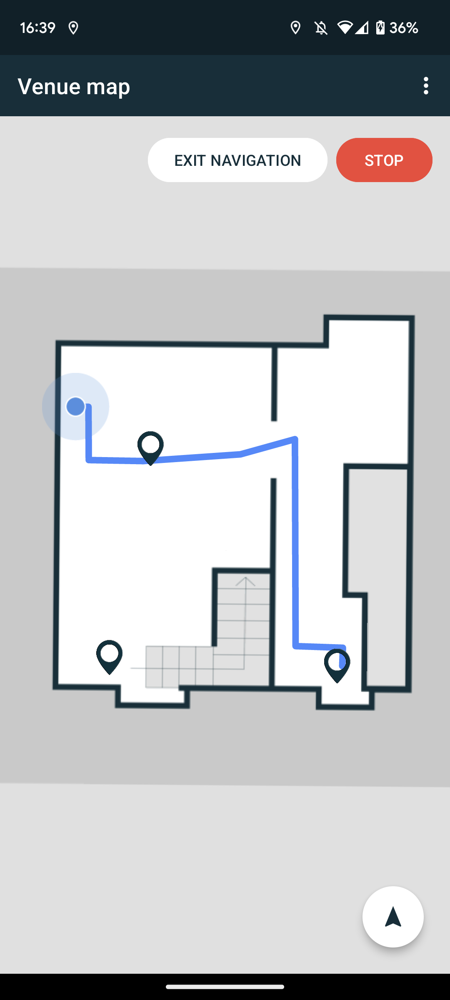

# Navigation

!!!note
    A path with the map graph should be defined using Nextome Web Frontend before using this feature.


Nextome Sdk is able to calculate the shortest path between two points of the same venue.

The function takes (x, y) coordinates and map of the starting point and (x, y) coordinates and map of the destination point.

=== "Android"
    ```kotlin
        val path = nextomeSdk.findPath(
            startX.toInt(), startY.toInt(), startMapId,
            targetX.toInt(), targetY.toInt(), targetMapId)
    ```
=== "iOS"
    ```swift
        nextomeSdk.findPath(venueId: venueId, sourceX: startX,
            sourceY: startY, sourceMap: startMapId,
            destX: targetX, destY: targetY, destMap: targetMapId,
            completionHandler: {path, error in
                guard error == nil else { return }
                guard let path = path else{ return }
            })
    ```

The returned path is a list of ordered Vertex, that, for example, can be passed to the Flutter Map Module and displayed to the user (see the methods written below).

=== "Android"
    ```kotlin
        val path = nextomeSdk.findPathWithChangeMapSuggestions(
            startX.toInt(), startY.toInt(), startMapId,
            targetX.toInt(), targetY.toInt(), targetMapId)
    ```
=== "iOS"
    ```swift
        nextomeSdk.findPathWithChangeMapSuggestions(venueId: venueId, sourceX: startX,
            sourceY: startY, sourceMap: startMapId,
            destX: targetX, destY: targetY, destMap: targetMapId,
            completionHandler: {path, error in
                guard error == nil else { return }
                guard let path = path else{ return }
            })
    ```

The returned value is a PathFinderResult thant contains a list of ordered vertices like findPath do, and a changeMap info as PathFinderChangeMapResult object described below. 
The changeMap attribute, when presents, specify only the next change map information. If no changemap is presents, then changeMap will be null. 

### PathFinderChangeMapResult

| Field | Type | Notes |
|-------|------|-------|
| `action` | PathFinderChangeMapAction | Identifier the direction and it can be UNDEFINED, GO_TO, GO_UP, GO_DOWN |
| `fromMapId` | INT | The current map id |
| `toMapId` | INT | The map id of destination action |
| `onVertex` | Vertex | The vertex where the action is assigned (usually the last vertex of the current path inside the current floor) |

<p style="text-align: center;"></p>